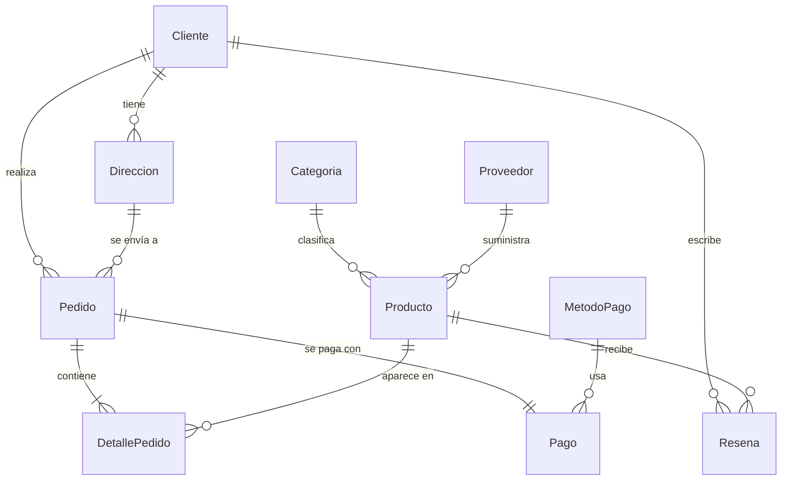

# Taller 3 — Migración SQL Server → MongoDB (Tienda Online)

Caso de estudio: tienda online (e-commerce). Base relacional de 10 entidades con ~12.800 registros, migrada a un modelo documental de 6 colecciones.

## Estructura del repositorio

| Archivo | Entregable que cubre |
|---|---|
| `01_schema.sql` | Script de creación de la BD en SQL Server |
| `02_generate_data.py` | Carga de datos (más de 5.000 registros) |
| `03_migrate.py` | Código de migración hacia MongoDB |
| `04_verify.py` | Verificaciones posteriores a la migración |
| `05_queries.py` | Aggregation Pipelines + justificación de negocio |
| `README.md` | Modelos, decisiones de modelado, instrucciones |
| `evidencias/` | Capturas (ver checklist abajo) |
| `presentacion.pptx` | Presentación de la sustentación |

## Cómo ejecutarlo

```bash
pip install -r requirements.txt
# 1. En SSMS ejecutar 01_schema.sql
python 02_generate_data.py   # llena SQL Server
python 03_migrate.py         # migra a MongoDB
python 04_verify.py          # comprueba la migración
python 05_queries.py         # ejecuta las 7 consultas (o: python 05_queries.py 3)
```

Requisitos: SQL Server + ODBC Driver 17/18, MongoDB local en `localhost:27017`. Ajusta las cadenas de conexión al inicio de cada script.

## Modelo relacional (10 entidades)



Volumen: Categoria 10 · Proveedor 30 · MetodoPago 5 · Producto 300 · Cliente 800 · Direccion ~1.600 · Pedido 2.000 · DetallePedido ~6.000 · Pago 2.000 · Resena 1.500.

## Modelo documental (6 colecciones)

```
clientes     { _id, nombre, email, telefono, fecha_registro, direcciones:[{...}] }
productos    { _id, nombre, precio, stock, categoria:{id_categoria,nombre}, proveedor_id }
proveedores  { _id, nombre, email, telefono, ciudad }
metodos_pago { _id, nombre }
pedidos      { _id, cliente_id, fecha, estado, total,
               direccion_envio:{ciudad,departamento,direccion},
               items:[{producto_id,nombre_producto,cantidad,precio_unitario,subtotal}],
               pago:{metodo_id,monto,fecha_pago,estado} }
resenas      { _id, cliente_id, producto_id, calificacion, comentario, fecha }
```

## Decisiones de Embedding vs Referencing

| Relación SQL | Decisión | Justificación |
|---|---|---|
| DetallePedido → Pedido | **Embedding** (array `items`) | Los ítems no existen sin el pedido y siempre se leen juntos. Se guarda `precio_unitario` y `nombre_producto` como foto histórica de la venta. |
| Pago → Pedido | **Embedding** (subdocumento `pago`) | Relación 1:1, siempre se consulta con el pedido. |
| Direccion → Cliente | **Embedding** (array `direcciones`) | Pocas por cliente (1 a 3), pertenecen al cliente y se leen con él. |
| Direccion → Pedido | **Embedding** como snapshot (`direccion_envio`) | Si el cliente cambia su dirección, el pedido histórico no debe cambiar. |
| Categoria → Producto | **Embedding** (`categoria`) | Catálogo pequeño y casi estático; evita un `$lookup` en cada consulta de producto. |
| Proveedor → Producto | **Referencing** (`proveedor_id`) | Existe por sí mismo y lo usan muchos productos; evita duplicar y desactualizar sus datos. |
| MetodoPago → Pago | **Referencing** (`pago.metodo_id`) | Catálogo compartido por todos los pagos. |
| Pedido → Cliente | **Referencing** (`cliente_id`) | Un cliente tiene muchos pedidos: embeberlos haría crecer el documento sin límite. |
| Resena → Producto/Cliente | **Referencing** (colección propia) | Crece sin límite y se consulta por producto y por cliente. |

Cada `_id` conserva el ID original de SQL Server, lo que facilita verificar y rastrear los datos.

## Verificación de la migración

`04_verify.py` comprueba: conteos por entidad, que las filas de Direccion/DetallePedido/Pago coincidan con los elementos de los arrays/subdocumentos, que las sumas de dinero sean idénticas en ambos motores, que ningún pedido tenga total distinto a la suma de sus ítems, que no existan referencias huérfanas y la comparación de un pedido concreto.

## Checklist de evidencias (carpeta `evidencias/`)

- [ ] Captura del diagrama relacional (SSMS → Database Diagrams) y del modelo documental.
- [ ] Captura de `SELECT COUNT(*)` por tabla en SQL Server.
- [ ] Captura de las colecciones en MongoDB Compass (con un documento de `pedidos` expandido).
- [ ] Captura de la salida de `04_verify.py` (todo en OK).
- [ ] Captura de la salida de cada consulta de `05_queries.py`.

## Preparación para la sustentación

Cada integrante debe poder explicar: por qué cada relación quedó embebida o referenciada, qué hace cada etapa (`$match`, `$unwind`, `$group`, `$lookup`, `$project`, `$sort`, `$limit`) en cada consulta, y modificar una consulta en vivo (por ejemplo: cambiar el top 10 a top 5, filtrar por un rango de fechas o por una categoría, o sumar otro `$lookup`).
